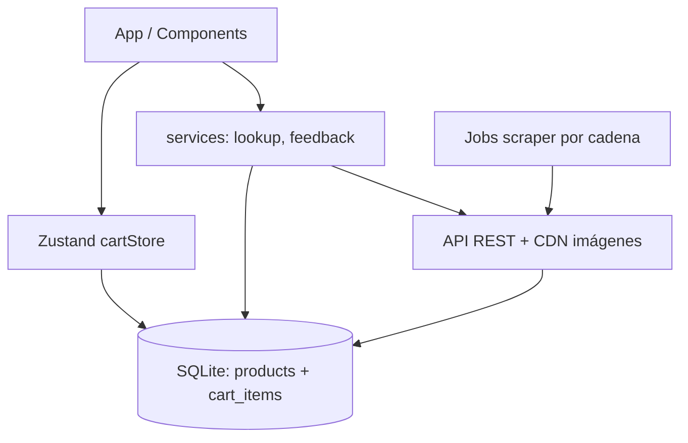

# Lista Fácil — Escáner de compras para supermercado

App móvil Android/iOS con **React Native + Expo**, pensada para máxima simplicidad (adultos mayores).

## Requisitos

- Node.js 18+
- Expo Go o emulador Android/iOS

```bash
cd lista-compras-scanner
npm install
npx expo start
```

## Estructura del proyecto

```
lista-compras-scanner/
├── app/                    # Expo Router (pantallas)
│   ├── _layout.tsx         # Navegación + hidratación del carrito
│   ├── index.tsx           # Pantalla 1: Supermercados
│   └── cart.tsx            # Pantalla 2: Lista + escáner
├── src/
│   ├── components/         # UI reutilizable
│   │   ├── cart/           # CartItemRow, TotalFooter
│   │   ├── scanner/        # BarcodeScannerModal
│   │   ├── ads/            # Banners (AdMob después)
│   │   └── ui/             # BigButton, QuantityStepper
│   ├── db/                 # SQLite local
│   ├── services/           # lookup, feedback háptico/audio
│   ├── store/              # Zustand + persistencia SQLite
│   ├── theme/              # Tokens accesibles
│   └── types/
└── package.json
```

## Arquitectura (capas)



| Capa | Responsabilidad |
|------|-----------------|
| **UI** | Pantallas accesibles, escáner, lista, total fijo |
| **Estado** | Carrito en memoria; sync a SQLite en cada cambio |
| **Local** | Catálogo cacheado + lista activa (sobrevive cierre de app) |
| **Remoto** | Catálogo maestro, precios, banners premium |

## Base de datos

### Local (SQLite — `expo-sqlite`)

Ver `src/db/schema.sql` y `src/db/database.ts`.

- `products` — caché por `barcode` + `supermarket_id`
- `cart_sessions` — sesión de compra
- `cart_items` — líneas de la lista activa

### Remota (PostgreSQL sugerido)

```sql
-- Cadenas
CREATE TABLE supermarkets (
  id UUID PRIMARY KEY,
  name VARCHAR(120) NOT NULL,
  slug VARCHAR(60) UNIQUE NOT NULL,
  logo_url TEXT,
  is_active BOOLEAN DEFAULT true
);

-- Catálogo maestro
CREATE TABLE products (
  id UUID PRIMARY KEY,
  barcode VARCHAR(32) NOT NULL,
  name VARCHAR(255) NOT NULL,
  brand VARCHAR(120),
  image_url TEXT,
  supermarket_id UUID REFERENCES supermarkets(id),
  price DECIMAL(12,2) NOT NULL,
  currency CHAR(3) DEFAULT 'ARS',
  source_url TEXT,
  scraped_at TIMESTAMPTZ,
  UNIQUE (barcode, supermarket_id)
);

CREATE INDEX idx_products_lookup ON products (barcode, supermarket_id);

-- Publicidad
CREATE TABLE ad_slots (
  id UUID PRIMARY KEY,
  supermarket_id UUID,
  placement VARCHAR(20), -- 'home_premium' | 'cart_footer'
  creative_url TEXT,
  starts_at TIMESTAMPTZ,
  ends_at TIMESTAMPTZ
);
```

**Sync:** la app descarga deltas por supermercado (`If-Modified-Since` / versión de catálogo) y rellena SQLite para búsqueda offline en el pasillo.

## UI — resumen de diseño

| Elemento | Especificación |
|----------|----------------|
| Texto clave | ≥ 18px (`typography.body`) |
| Botones +/- | 72×72 dp, alto contraste |
| Total | 36px, peso 900, color primario |
| Primario | `#0D7C66` (verde calmado) |
| Feedback scan | Vibración + beep (`expo-haptics`, `expo-av`) |

## Próximos pasos

1. Integrar `react-native-google-mobile-ads` en `AdBannerPlaceholder`
2. API Node/FastAPI + pipeline scraper por cadena
3. Seed inicial de productos en SQLite al elegir supermercado
4. Modo alto contraste / tamaño de fuente en ajustes

## Probar escaneo (mock)

En **Carrefour**, escanee o simule códigos:

- `7790310981234` — Leche
- `7790895001234` — Pan
